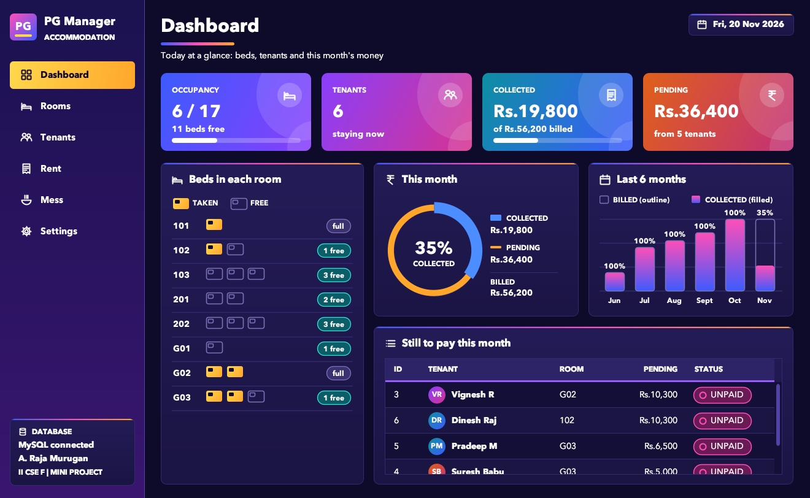

# PG Accommodation Management System

**II CSE F mini project (DS + OOPS concepts): A. Raja Murugan**
Rajalakshmi Institute of Technology, Department of CSE

| | |
|---|---|
| Title | PG Accommodation Management System (JDBC + MySQL) |
| Modules | Room, Tenant, Rent, Mess |
| DS concept | Array |
| Language | Java (works on Java 8 and newer) |
| Database | MySQL, reached through JDBC |

An app for the owner or warden of a PG hostel. It keeps rooms and beds,
registers tenants and gives them beds, bills rent and mess every month, records
payments, shows who has not paid, and runs the mess plans and weekly menu.

**Website:** https://rajamurugan181707.github.io/pg-accommodation-manager/

## Download and run (no build needed)

From the repository's **Releases** page, download:
- **`PG-Manager.jar`**: the whole app in one file, with the MySQL driver included
- **`pg-accommodation-source.zip`**: the source code, SQL script and run scripts

Then:
1. Install **Java 8 or newer** and **MySQL**.
2. Create the database: `mysql -u root -p < sql/schema.sql`. The script is in the ZIP
   and in this repo.
3. Put a `db.properties` file next to the JAR with your MySQL login. Copy the one in this
   repo and change `db.user` / `db.password`, for example to `root` and your password.
4. Start the app:
   - **GUI:** `java -jar PG-Manager.jar`
   - **Console:** `java -cp PG-Manager.jar com.pgms.ui.Main`

There are two front ends over the same code. Both read and write the same MySQL data:
- **Swing window (GUI):** `./run-gui.sh`, or `run-gui.bat` on Windows
- **Console menus:** `./run.sh`, or `run.bat` on Windows



---

## 0. The Swing GUI

The window has a sidebar on the left: the **PG** logo, one button per page (the current
page is the bright button with a gold bar), and a card showing the database status and
the student's name. Each page has a large title, a one-line description, and today's date.

| Page | What you see and do |
|---|---|
| **Dashboard** | Four headline cards (occupancy with a progress bar, tenants, collected, pending); a **bed map** for each room; a **collection ring** for this month; a **6-month bar chart** (outline = billed, filled part = collected, % written on top); and the "still to pay" list |
| **Rooms** | Every room as a **card**: room number, floor, type, AC, a bed shape per bed (filled = taken, outline = free), rent, and a FULL / x FREE tag. Click a card to select it (gold outline plus the word SELECTED). **Find room** uses binary search and selects the card. You can also filter to free beds only, sort by rent, and Add / Change rent / Delete |
| **Tenants** | A search box that filters as you type (linear search); a table with **initials avatars** and **status pills**; Register, Details, Shift room, Change mess plan, Check out |
| **Rent** | A month picker, three cards (billed / collected with % / pending), and the dues table with PAID / PARTIAL / UNPAID pills. Buttons: Record payment, View bill, Full statement, Payments this month |
| **Mess** | Each plan as a card (bowl icons per meal, price, tenant count), total eating and mess income, Add plan, and the weekly menu with today marked "(TODAY)" |

How it works:
- Every save shows a short **confirmation toast** in the bottom-right corner, and the
  same message is written in the page's status line.
- Forms open as pop-ups with rounded fields. A wrong entry shows a message and the form
  reopens with everything still filled in.

**Colours and readability (colour-blind safe):**
- All text is white on a dark background. The only dark text is on the bright azure
  buttons.
- Colour appears only in graphics: icon rings, outlines, bars and the ring.
- Every state is also given in words and in shape:

| State | Words | Shape |
|---|---|---|
| Paid / active | PAID, ACTIVE | ✓ tick |
| Partly paid | PARTIAL | half-filled circle |
| Not paid | UNPAID | empty circle |
| Left | LEFT | dash |

Elsewhere: a bed is filled when taken and an outline when free. Billed is an outline and
collected is a filled bar. The collected arc of the ring is thick and the pending arc is
thin.

**How it is built:** everything is drawn with Swing and Java2D, so there are no image
files or extra libraries, and it still runs on Java 8.
- `Theme` sets the colours and fonts (Avenir Next on Mac, Segoe UI on Windows).
- `PgButtonUI`, `PgScrollBarUI` and `PgField` give rounded buttons, scrollbars and text boxes.
- `Icons` draws the line icons.
- `RoundPanel`, `StatCard`, `RoomCard` and `PlanCard` are the cards.
- `PgTable` adds avatars and pills to tables.
- `DonutChart`, `MonthBars` and `OccupancyChart` are the charts.
- `Toast` is the slide-in confirmation.

Each page calls the same `service` classes as the console menus, so the rules (full
rooms, overpayment, frozen bills, input checks) are identical in both.

More screenshots: [Settings](docs/gui-settings.png) · [Edit payment](docs/gui-edit-payment.png) · [Rooms](docs/gui-rooms.png) · [Tenants](docs/gui-tenants.png) ·
[Rent](docs/gui-rent.png) · [Mess](docs/gui-mess.png) · [Register form](docs/gui-register-form.png) · [Statement](docs/gui-statement.png)

---

## Everything is editable

Every record can be corrected after it is saved, from the GUI or the console. The same
safety rules still apply to every edit.

| What | Edit | Rules kept |
|---|---|---|
| **Room** | number, floor, type, AC, rent (**Rooms → Edit room**) | number stays unique; a room cannot shrink below the people in it; old bills keep their old rent |
| **Tenant** | name, phone, email, gender, occupation, deposit, joining date (**Tenants → Edit details**) | phone unique among current tenants; joining date not after leaving date |
| **Payment** | amount, date, mode, note, or delete it (**Rent → Edit payment**) | a month's payments can never add up to more than its bill; no future dates |
| **Bill** | one month's room rent and mess charge, e.g. a discount (**Rent → Edit bill**) | cannot go below what is already paid; no future months |
| **Mess plan** | name, meals, charge, or delete it (click a plan card, then **Edit plan / Delete plan**) | names unique; a plan any tenant has used cannot be deleted |
| **Menu** | any day's meals (**Mess → Edit selected day**) | - |
| **Names in the app** | PG name, tagline, owner name, footer line (**Settings** page) | shown live in the sidebar and window title |

Room shifts, mess-plan changes and check-outs have their own buttons, because they
change beds and bills, not just details.

## 1. What each module does

### Room
- View all rooms, or only rooms with free beds
- Search a room by number (**binary search** on the sorted array)
- View rooms sorted by rent (**insertion sort**)
- Add a room (single / double / triple, AC or not, rent per bed)
- Change a room's rent
- Delete a room (only if it is empty and has never had a tenant)

### Tenant
- Register a tenant and give them a bed: checks the phone number, refuses a full room
- View current tenants and past tenants
- Search tenants by name (**linear search**)
- View one tenant's full details
- Shift a tenant to another room
- Check out a tenant: shows the deposit held and any unpaid rent first, then frees the bed

### Rent
- Every month each tenant is billed **bed rent + mess charge**
- Record a payment (cash / UPI / card / bank); part payments are allowed, overpaying is not
- Monthly dues: everyone's bill, paid and pending, with the most pending first
- A tenant's bill for one month, item by item
- A tenant's full statement from the month they joined, with all receipts
- All payments received in a month

### Mess
- Mess plans (breakfast only / two meals / full board) with the headcount and income for each
- Add a plan
- Change a tenant's plan, or take them off the mess
- View and edit the weekly menu

The main screen also shows a dashboard: beds taken and free, number of tenants,
and this month's billed and pending amounts.

---

## 2. Where the DS and OOPS concepts are (for the viva)

### Data structure: Array (`src/com/pgms/ds/DynamicArray.java`)
A growable array written by hand. It does **not** use `ArrayList`. Every list of
rooms, tenants, payments, plans and bills in the app is one of these.

| Operation | How | Time |
|---|---|---|
| `add` | Put the item in the next free slot; if the array is full, copy everything into an array twice the size first | O(1) on average |
| `get` / `set` | Direct index | O(1) |
| `removeAt` | Shift every later item one place to the left | O(n) |
| `indexOf`, `filter` | **Linear search** (tenant search by name, vacant rooms, finding a plan) | O(n) |
| `sort` | **Insertion sort** (rooms by number or rent, dues by pending amount) | O(n²) |
| `binarySearch` | **Binary search** on rooms sorted by number (Room → Search) | O(log n) |

Plain Java arrays are used too:
- `Billable[]` holds the items on a bill (bed + mess plan)
- `int[]` holds the mess headcount, where `counts[i]` belongs to `plans.get(i)`
- `int[]` holds the bed summary `{total, occupied}`
- `String[]` holds the days of the week

### OOPS
| Concept | Where |
|---|---|
| **Class & object** | `Room`, `Tenant`, `MessPlan`, `RentPayment`, `DayMenu` |
| **Encapsulation** | All fields are `private`; setters check values (`setPhone` accepts only 10-digit mobiles, `setRentPerBed` refuses 0 or less) |
| **Abstraction** | `abstract class Person`, with the abstract method `role()` |
| **Inheritance** | `Tenant extends Person` |
| **Interface** | `Billable` (`monthlyCharge()`, `billLabel()`), implemented by `Room`, `MessPlan` and `BillItem` |
| **Polymorphism** | `DueLine.due()` adds up a `Billable[]` without knowing whether each item is a room, a mess plan or a saved bill line; `role()` is overridden |
| **Enums** | `RoomType` (with its number of beds), `Gender`, `PaymentMode`, `TenantStatus` |
| **Exceptions** | Wrong input raises `IllegalArgumentException` with a clear message; database problems raise `SQLException` |
| **Layers** | `ui` (menus) → `service` (rules) → `dao` (SQL) → `db` (connection) |

### JDBC
- `DBConnection` reads `db.properties` and opens connections with `DriverManager`
- Every query uses `PreparedStatement`, so typed input is never pasted into SQL (no SQL injection)
- **Transactions** (`setAutoCommit(false)` → `commit()` / `rollback()`) wrap register, shift
  and checkout, because each one changes both `tenants` and `rooms`
- The bed count is changed with `UPDATE ... WHERE occupied + ? BETWEEN 0 AND capacity`,
  so a room can never go over capacity, even if two people book its last bed at once
- `RETURN_GENERATED_KEYS` gets the new ID after each insert

---

## 3. Database (`sql/schema.sql`)

| Table | Holds |
|---|---|
| `rooms` | room number, floor, type, capacity, beds taken, rent per bed, AC |
| `tenants` | personal details, room, mess plan, join / leave date, deposit, status |
| `mess_plans` | plan name, meals per day, monthly charge |
| `mess_menu` | breakfast / lunch / dinner for each day of the week |
| `monthly_bills` | one bill per tenant per month, saved once and never changed |
| `rent_payments` | each payment: tenant, month, amount, date, mode, note |

**Why `monthly_bills` exists:** if bills were worked out from the tenant's
current room, then shifting a tenant to a costlier room would change their old,
already-paid bills too. So each bill is saved the first time its month comes up,
and when the app starts it makes any missing bills up to the current month. After
that, a rent change, room shift or plan change only affects new bills.

The script also loads sample data: 8 rooms, 3 mess plans, a weekly menu, 6 tenants,
and their payments. June to October are fully paid; in November one tenant has
paid in full, one has paid part, and four have not paid yet.

---

## 4. How to run it

### What you need
1. **Java** (JDK 8 or newer): check with `java -version`
2. **MySQL** server
3. The MySQL JDBC driver, already included as `lib/mysql-connector-j-9.1.0.jar`

### Step 1: create the database
```bash
mysql -u root -p < sql/schema.sql
```
(On this MacBook root has no password, so `mysql -u root < sql/schema.sql` works.)
This **wipes and re-creates** the tables, so only run it again if you want the
sample data back.

### Step 2: set the login in `db.properties`
On this MacBook it is already set to a user created only for this project:
```
db.user=pg_user
db.password=pg_pass_123
```
On a college lab PC, change these to that machine's MySQL user, for example
`db.user=root` and its password.

### Step 3: run
| | GUI window | Console menus |
|---|---|---|
| macOS / Linux | `./run-gui.sh` | `./run.sh` |
| Windows | double-click `run-gui.bat` | double-click `run.bat` |

Each script compiles everything into `out/` and starts the app.

To do it by hand:
```bash
javac -d out $(find src -name "*.java")
java -cp "out:lib/mysql-connector-j-9.1.0.jar" com.pgms.gui.MainWindow   # GUI, macOS / Linux
java -cp "out;lib\mysql-connector-j-9.1.0.jar" com.pgms.gui.MainWindow   # GUI, Windows
java -cp "out:lib/mysql-connector-j-9.1.0.jar" com.pgms.ui.Main          # console
```

### Starting and stopping MySQL on this MacBook
MySQL was installed with Homebrew and does **not** start by itself at login.
```bash
mysql.server start
mysql.server stop
```

---

## 5. A quick demo for the review (GUI)
Reset the sample data first: `mysql -u root < sql/schema.sql`. Then `./run-gui.sh`.
1. **Dashboard**: beds taken and free, this month's money, the bed map, who owes.
2. **Rooms**: type `102` and click **Find room**. It is found by binary search and its card
   is selected (gold outline, "SELECTED"). Switch to **Sort by rent**, then tick
   **Only rooms with free beds**.
3. **Tenants**: type `ka` in Search name; the list filters as you type (linear search).
   Click **Register tenant**:
   - Type a wrong phone like `12345` to show the message.
   - Fix it, pick room `G01`, and save.
   - Note that the room list only offers rooms with a free bed.
4. **Rent**: click Karthik S, then **Record payment** and pay Rs.2,000; his status stays
   PARTIAL. Then click **View bill**, and **Full statement**.
5. **Tenants**: click Suresh Babu, then **Shift room**. Back on **Rent**, his bill for
   November is unchanged: bills are frozen once made.
6. **Mess**: plans with headcount and income; **Edit selected day** on the menu.
7. **Tenants**: click someone with dues, then **Check out**. It shows the deposit and
   unpaid rent before confirming.

The same steps work in the console version (`./run.sh`) through numbered menus.

---

## 6. Project structure
```
pg-accommodation/
├── README.md
├── db.properties              MySQL login used by the app
├── run-gui.sh / run-gui.bat   compile + open the Swing window
├── run.sh / run.bat           compile + run the console menus
├── docs/                      GUI screenshots
├── lib/mysql-connector-j-9.1.0.jar
├── sql/schema.sql             tables + sample data
└── src/com/pgms/
    ├── ds/DynamicArray.java   the Array data structure
    ├── model/                 Person, Tenant, Room, MessPlan, RentPayment, BillItem,
    │                          DayMenu, Billable (interface), enums
    ├── db/DBConnection.java   JDBC connection
    ├── dao/                   SQL for each table (RoomDAO, TenantDAO, RentDAO, MessDAO, BillDAO)
    ├── service/               rules for each module (RoomService, TenantService,
    │                          RentService, MessService, DueLine)
    ├── gui/                   Swing window (MainWindow, one panel per page,
    │                          OccupancyChart, Theme, Ui, Form)
    ├── ui/                    console menus (Main, RoomMenu, TenantMenu, RentMenu,
    │                          MessMenu, ConsoleInput)
    └── util/                  Money (Indian number format), Dates, Table
```

## 7. Input checks (all in `util/Check.java`, used by both console and GUI)
Bad input is stopped with a clear message before it reaches MySQL. The console asks
again; the GUI form reopens with everything still filled in.

| What | Rule |
|---|---|
| Amounts (rent, deposit, mess charge, payment) | A real number, rounded to paise, at most Rs.1,00,00,000. A deposit may be 0; the others must be more than 0 |
| Dates | Exactly `yyyy-mm-dd` (`2026-11-20xyz` is refused) |
| Joining date | At most 31 days ahead (a bed can be booked ahead) |
| Leaving date / payment date | Not in the future. Checking out frees the bed at once, so it is done on the day the tenant leaves |
| Months for bills | Not after the current month. Bills are frozen when made, so a future month is not billed early |
| Phone | 10-digit Indian mobile. It must be unique among **current** tenants, so a past tenant can come back |
| Email | Optional; if given it must look like `name@site.com` |
| Text | Never longer than its database column (name 60, occupation 40, note 80, ...) |
| Overpayment | Refused; you can pay at most the pending amount |
| Room full | Refused, both by the app and by the `UPDATE ... BETWEEN 0 AND capacity` guard in SQL |

If MySQL stops while the console app is running, it shows one message and waits for
Enter (try again) or 0 (exit). The GUI shows a pop-up for each action instead.

## 8. Limits (good to mention if asked "what would you add next?")
- A tenant who joins mid-month pays the full month (no part-month billing)
- No login screen; it is a single-user tool for the warden
- The GUI talks to MySQL on the screen's own thread, which is fine for a small PG; a
  bigger system would load data in the background (`SwingWorker`) so the window never pauses
- Insertion sort and linear search are fine for a PG with a few hundred rows; a much
  bigger hostel would want database indexes or `ORDER BY` and a faster sort
